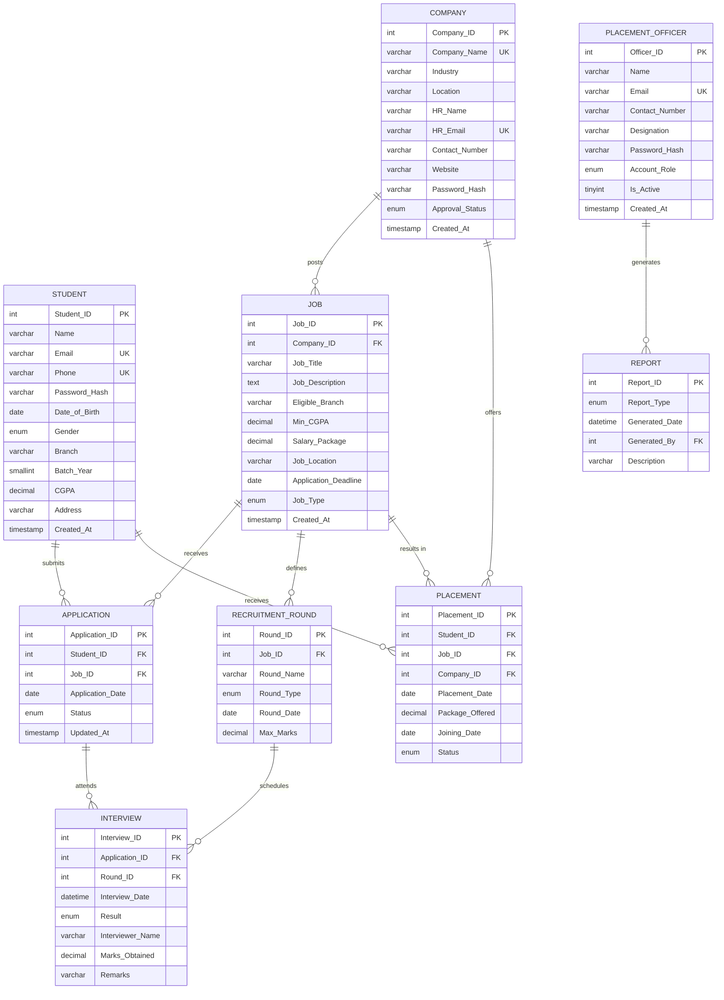

# Entity–Relationship Diagram

The database uses exactly **nine tables**. The diagram below is written in
Mermaid, which GitHub, GitLab and VS Code (with a Mermaid extension) render
automatically. A text explanation of every relationship follows.

---

## Relationship explanations

| # | Parent | Child | Cardinality | Meaning | Delete rule |
|---|---|---|---|---|---|
| 1 | `Company` | `Job` | 1 : N | One company posts many jobs; each job belongs to one company. | CASCADE |
| 2 | `Student` | `Application` | 1 : N | One student submits many applications. | CASCADE |
| 3 | `Job` | `Application` | 1 : N | One job receives many applications. | CASCADE |
| 4 | `Application` | `Interview` | 1 : N | One application can be interviewed in several rounds. | CASCADE |
| 5 | `Recruitment_Round` | `Interview` | 1 : N | One round schedules many candidate interviews. | CASCADE |
| 6 | `Job` | `Recruitment_Round` | 1 : N | One job defines its own ordered round list. | CASCADE |
| 7 | `Student` | `Placement` | 1 : N | One student may hold offers from different companies. | CASCADE |
| 8 | `Job` | `Placement` | 1 : N | A job can produce more than one offer. | RESTRICT |
| 9 | `Company` | `Placement` | 1 : N | Offers are counted per company for reports. | RESTRICT |
| 10 | `Placement_Officer` | `Report` | 1 : N | An officer/admin generates many reports. | RESTRICT |

### Many-to-many bridges

- **Student ↔ Job** is many-to-many, resolved by `Application` (with its own
  attributes: date and status).
- **Application ↔ Recruitment_Round** is many-to-many, resolved by `Interview`
  (with date, interviewer, marks and result).
- **Student ↔ Job** also appears in `Placement`, but this is *not* a pure
  bridge: it carries offer-specific data and has a separate uniqueness rule.

### Why `Placement` stores `Company_ID`

`Company_ID` can be derived through `Job.Company_ID`. It is stored anyway
because the project synopsis requires fast company-wise reports without an
extra join. Redundancy is controlled by triggers
(`trg_placement_company_check`, `trg_placement_company_check_update`) that
reject any row whose `Company_ID` disagrees with the job owner.

---

## Constraint summary

### Primary keys

`Student_ID`, `Company_ID`, `Officer_ID`, `Job_ID`, `Application_ID`,
`Round_ID`, `Interview_ID`, `Placement_ID`, `Report_ID` — all
`INT UNSIGNED AUTO_INCREMENT`.

### Unique keys

| Table | Unique key | Purpose |
|---|---|---|
| `Student` | `Email`, `Phone` | One login and one phone per student |
| `Company` | `Company_Name`, `HR_Email` | One account per company |
| `Placement_Officer` | `Email` | One login per officer/admin |
| `Application` | `(Student_ID, Job_ID)` | No duplicate application to the same job |
| `Recruitment_Round` | `(Job_ID, Round_Name)` | Round names unique within a job |
| `Interview` | `(Application_ID, Round_ID)` | One interview per candidate per round |
| `Placement` | `(Student_ID, Job_ID)` | No duplicate offer for the same job |

### CHECK constraints

| Table | Constraint | Rule |
|---|---|---|
| `Student` | `chk_student_cgpa` | `CGPA BETWEEN 0 AND 10` |
| `Student` | `chk_student_batch` | `Batch_Year BETWEEN 2000 AND 2100` |
| `Placement_Officer` | `chk_officer_active` | `Is_Active IN (0,1)` |
| `Job` | `chk_job_min_cgpa` | `Min_CGPA BETWEEN 0 AND 10` |
| `Job` | `chk_job_salary` | `Salary_Package >= 0` |
| `Recruitment_Round` | `chk_round_max_marks` | `Max_Marks > 0` |
| `Interview` | `chk_interview_marks` | `Marks_Obtained IS NULL OR >= 0` |
| `Placement` | `chk_placement_package` | `Package_Offered >= 0` |
| `Placement` | `chk_placement_joining` | `Joining_Date IS NULL OR >= Placement_Date` |

### Enumerations

- `Student.Gender`: `Male`, `Female`, `Other`
- `Company.Approval_Status`: `Pending`, `Approved`, `Rejected`
- `Placement_Officer.Account_Role`: `Officer`, `Admin`
- `Job.Job_Type`: `Full-Time`, `Internship`, `Internship + PPO`, `Part-Time`
- `Application.Status`: `Applied`, `Under Review`, `Shortlisted`,
  `Interview Scheduled`, `Selected`, `Rejected`, `Withdrawn`
- `Recruitment_Round.Round_Type`: `Aptitude`, `Technical`, `HR`,
  `Group Discussion`, `Coding`, `Other`
- `Interview.Result`: `Pending`, `Pass`, `Fail`, `On Hold`
- `Placement.Status`: `Offer Released`, `Offer Accepted`, `Offer Declined`,
  `Joined`, `Withdrawn`
- `Report.Report_Type`: `Placement Summary`, `Branch-wise Report`,
  `Company-wise Report`, `Unplaced Students`, `Recruitment Summary`, `Other`

### Indexes

| Index | Table | Columns | Reason |
|---|---|---|---|
| `idx_job_deadline` | `Job` | `Application_Deadline` | Filter open jobs |
| `idx_application_job_status` | `Application` | `(Job_ID, Status)` | Applicant lists and funnel counts |

---

## Normalization notes

- **1NF:** every column is atomic. The one deliberate exception is
  `Job.Eligible_Branch`, stored as a comma-separated list to keep the table
  count at nine. It is only ever queried with `FIND_IN_SET`, never parsed in
  application code.
- **2NF:** all non-key columns depend on the whole primary key. Bridge tables
  (`Application`, `Interview`) have surrogate keys plus a unique composite key,
  so no partial dependency exists.
- **3NF:** no non-key column depends on another non-key column. The only
  transitive-looking case, `Placement.Company_ID`, is intentional redundancy
  protected by triggers.
- **BCNF:** each determinant is a candidate key except the intentional
  `Eligible_Branch` list and derived `Company_ID`; both are documented design
  decisions for the project constraints.

---

## Rendering the diagram

- **GitHub / GitLab:** paste this file; the Mermaid block renders automatically.
- **VS Code:** install *Markdown Preview Mermaid Support* and open the preview.
- **draw.io:** *Arrange → Insert → Advanced → Mermaid*.
- **MySQL Workbench:** *Database → Reverse Engineer* after running
  `schema.sql` to generate a physical ER diagram from the live database.
